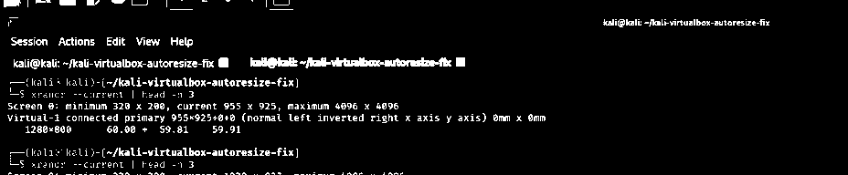

# Test Results and Evidence

This document records observations from the author's Kali Linux VirtualBox troubleshooting session on 26 November 2026 (UTC). It is not a claim of cross-version compatibility.

## Environment observed

- Kali GNU/Linux Rolling; `PRETTY_NAME` reported Kali GNU/Linux 2025.4
- Kernel: `6.16.8+kali-amd64`
- Desktop: XFCE
- Session: X11
- Guest Additions packages: `virtualbox-guest-utils` and `virtualbox-guest-x11`, version `7.2.8`
- Kernel modules: `vboxguest` and `vboxsf`
- Display output: `Virtual-1`

## Diagnostic observations

| Check | Observed result |
|---|---|
| `xrandr --current` with smaller VM window | `Virtual-1` at `955x925` |
| `xrandr --current` with maximized VM window | `Virtual-1` at `1920x937` |
| `XDG_SESSION_TYPE` | `x11` |
| `VBoxClient --vmsvga -f -v` | Reported the SVGA X11 display service was already running |
| Guest service journal | Included `XDG_RUNTIME_DIR is invalid or not set` at service startup |
| Guest service journal | Included `VMSVGA DRM resizing client not started, rc=VERR_FILE_NOT_FOUND` |
| `VBoxControl guestproperty enumerate` | Returned “Could not contact the host system” |
| `dpkg-divert --truename /usr/bin/VBoxDRMClient` after rollback | Returned `/usr/bin/VBoxDRMClient` |

## Visual evidence

The terminal capture below records the two observed `xrandr` outputs from the same troubleshooting session.

## Final resize validation

The final successful resize check was performed after restoring the original `/usr/bin/VBoxDRMClient` executable and enabling **View → Auto-resize Guest Display** in the VirtualBox window.

- Smaller window: `955x925`
- Maximized window: `1920x937`

**Outcome:** the guest display dimensions changed when the VM window size changed in this final test.

## Interpretation and limitations

- The observed resize behavior is evidence that automatic resizing worked in this particular final configuration.
- The session did not isolate a single root cause.
- The earlier `dpkg-divert` experiment was reverted before the final successful validation. Therefore, the result must not be attributed to that experiment.
- A VirtualBox application error occurred during one earlier test involving the display-resize setting.
- The guest package version was reported as 7.2.8, while the kernel log reported host version 7.1.6r167084. This mismatch is recorded for follow-up; it is not proof of causation.
- The diagnostic script has not been tested on a broad matrix of Kali, kernel, VirtualBox, or Guest Additions versions.

## Reproduction checklist

1. Record host VirtualBox version and guest package versions.
2. Take a VM snapshot before changing package-managed files.
3. Run `bash commands/diagnostics.sh` and retain the output.
4. Confirm the VirtualBox **Auto-resize Guest Display** menu setting.
5. Record `xrandr --current` at a small and maximized VM window size.
6. Change only one variable at a time and repeat the test.
7. If an experimental diversion was applied, verify its state and follow the rollback procedure before concluding the test.

No automated integration test or independent reproduction is claimed in this report.
